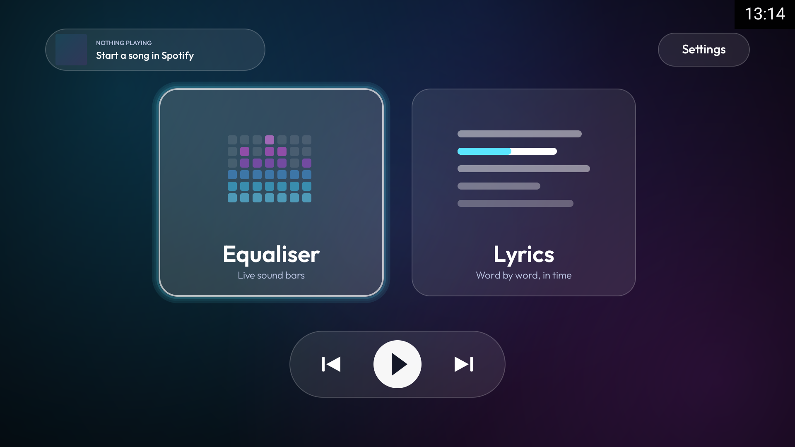
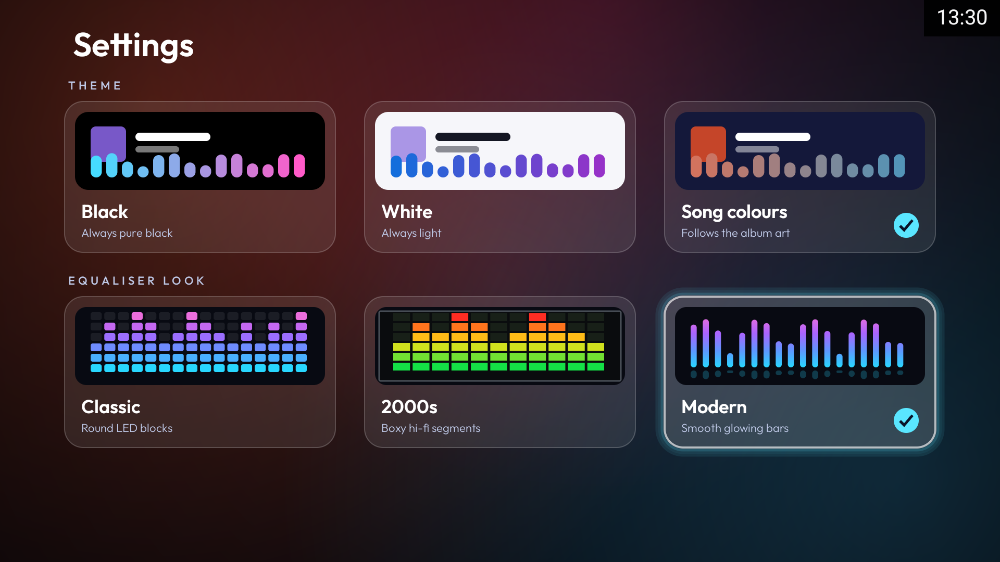

# Soundlit

**A live equaliser and word-by-word lyrics screen for Spotify on Android TV and Google TV.**

Soundlit reads what Spotify is playing on your TV and turns the screen into a music display: LED bars that move to the real audio, and time-synced lyrics that type themselves out like a Kindle page. It is made for the remote, with no touch targets and no on-screen back button.

Built and tested on a Sony Bravia (Android 14 / Google TV).




## Features

- **Equaliser** with three looks you can switch in Settings:
  - **Classic** – round LED blocks, bottom-up, in a cyan to pink ramp
  - **Kindle** – a digital equaliser in cream ink, straight on the background
  - **Modern** – slim glowing bars with floating peaks and a soft reflection
- **Lyrics** – time-synced lines typed out word by word in a book serif font (Lora)
- **Themes** – permanent **Black**, **White**, or **Song colours** that follow the album art
- **Real audio** – bars react to the TV's actual output through Android's `Visualizer`, with a simulated fallback if a TV blocks it
- **Now playing and controls** – title, artist, album art and progress, plus previous / play-pause / next from the menu
- **Remote friendly** – D-pad and OK only; Back goes to the menu, and from the menu it exits
- **Tiny** – about 200 KB, no third-party libraries, one custom `Canvas` view laid out at 1920×1080 and scaled to any screen

## Install

1. Download `soundlit.apk` from the [latest release](../../releases/latest).
2. Sideload it onto your TV. With ADB over the network:
   ```
   adb connect <tv-ip>:5555
   adb install -r soundlit.apk
   adb shell pm grant com.soundlit.tv android.permission.RECORD_AUDIO
   adb shell cmd notification allow_listener com.soundlit.tv/com.soundlit.tv.MusicListener
   ```
   Without a PC you can instead use a file-manager app such as *Downloader*, then allow **Notification access** for Soundlit in the TV's settings and accept the audio permission when asked.
3. Open **Soundlit** from your apps row and start a song in Spotify.

Soundlit needs two permissions: **notification access** (the only way Android lets an app read another app's now-playing session) and **microphone / record audio** (required by the `Visualizer` API; Soundlit never records anything).

## How it works

| Piece | Source |
| --- | --- |
| Now playing and controls | `MediaSessionManager` plus a notification-listener service |
| Audio bars | `android.media.audiofx.Visualizer` on the output mix, FFT into 44 log-spaced bands with automatic gain |
| Lyrics | [LRCLIB](https://lrclib.net) (synced lyrics), with NetEase Cloud Music as a backup; word timing is estimated across each line |
| Fonts | [Outfit](https://fonts.google.com/specimen/Outfit) and [Lora](https://fonts.google.com/specimen/Lora), both under the SIL Open Font License |

## Build

Requires JDK 17 and the Android SDK (API 34).

```
./gradlew assembleRelease
```

The APK is written to `app/build/outputs/apk/release/`. It is signed with the debug key, so it is fine for sideloading but not for the Play Store.

## Good to know

- Lyrics come from community databases. Popular songs, including many Hindi and Bollywood tracks, are found; some songs have none, and then Soundlit says so.
- Some TVs block the `Visualizer`. If yours does, the bars switch to a simulated animation instead of showing nothing.
- Soundlit is not affiliated with Spotify, Sony or Google.

## Related projects

- [**CleanYourTV**](https://github.com/Gathin23/cleanyourtv) – a clean, Apple-TV-style launcher and debloat guide for Android TVs. Soundlit was built alongside it while tidying up a Sony Bravia, and the two work well together.
- [**LRCLIB**](https://lrclib.net) – the free, open lyrics database Soundlit uses.

## Licence

MIT, see [LICENSE](LICENSE). The bundled fonts keep their own SIL Open Font License.
